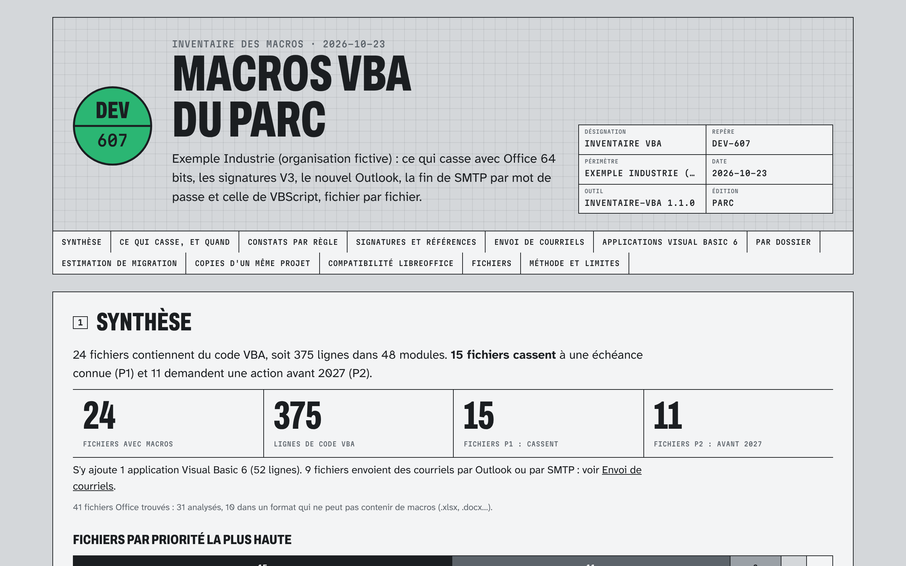

# inventaire-vba

Inventaire hors ligne des macros VBA d'un parc Office. Vous pointez un dossier ou un partage réseau, et vous savez en quelques minutes, fichier par fichier :

* ce qui **ne compile plus en Office 64 bits** (Declare sans PtrSafe, contrôles MSCOMCTL, Jet 4.0, DAO 3.6) ;
* ce qui sera **bloqué par la stratégie de signatures V3** (projets signés sans signature V3, certificats expirés) ;
* ce qui casse avec le **nouvel Outlook** (phase « opt-out » en entreprise en mars 2027), la **fin du SMTP par mot de passe** dans Exchange Online (fin décembre 2026), la **désactivation de VBScript** et la **désactivation des contrôles ActiveX** ;
* chaque **point d'envoi de courriels** (Outlook, `SendObject`, MAPI, CDO, SMTP), y compris dans les **applications Visual Basic 6** (`.vbp`) et les sources .NET, avec un module de remplacement par Microsoft Graph fourni ;
* ce qui dépend d'Internet Explorer, de DDE, de macros Excel 4.0, de chemins réseau écrits en dur ou d'une base de données ;
* combien de fichiers, de modules et de lignes de VBA vous avez, qui les a écrits, et lesquels sont des copies d'un même projet.



Rapport d'exemple complet, sur un parc fictif de 47 fichiers (dont une application VB6 et un outil .NET) : [exemples/exemple-industrie/rapport.html](exemples/exemple-industrie/rapport.html) ([classeur Excel](exemples/exemple-industrie/inventaire.xlsx), [inventaire.json](exemples/exemple-industrie/inventaire.json)). Le même parc, livré en diagnostic à distance avec la revue de l'expert : [rapport.pdf](exemples/exemple-industrie/diagnostic-livre/rapport.pdf).

## Pourquoi maintenant

Microsoft a retiré en 2024 le *Readiness Toolkit for Office add-ins and VBA*, qui servait à inventorier les macros, sans le remplacer. Or plusieurs échéances tombent sur les mêmes fichiers :

| Échéance | Quand | Ce qui casse |
|---|---|---|
| Office 64 bits | Installé par défaut depuis Office 2019 et Microsoft 365 | `Declare` sans `PtrSafe`, contrôles OCX 32 bits, Jet 4.0, DAO 3.6 |
| Contrôles ActiveX | Désactivés par défaut depuis Microsoft 365 2504 (avril 2025) et Office 2024 | Boutons et listes ActiveX posés sur les feuilles |
| Signatures V3 | Dès que la stratégie « Only trust VBA macros that use V3 signatures » est activée | Projets signés avec une signature ancienne ou agile |
| VBScript | Phase 2 « vers 2026 ou 2027 » : désactivé par défaut dans Windows | Scripts `.vbs` ; `VBScript.RegExp` sur Office LTSC, 2021, 2019, 2016 (pas sur Microsoft 365 2508 et plus, qui a un RegExp intégré) |
| SMTP AUTH | Désactivé par défaut dans Exchange Online fin décembre 2026 ; retrait définitif annoncé au second semestre 2027 | Envoi vers `smtp.office365.com` avec un mot de passe : CDO, `SmtpClient`, fichiers de configuration |
| Nouvel Outlook | Phase « opt-out » en entreprise en mars 2027 ; Outlook classique pris en charge jusqu'en 2029 au moins | Toute macro ou application qui pilote Outlook, `DoCmd.SendObject`, MAPI, CDO 1.21, Redemption |
| Parc mixte | Dès qu'un poste n'est pas en Microsoft 365 2508+ | `New RegExp` sans référence : ne compile pas sur LTSC |

Sources : liens dans le [catalogue des règles](#ce-qui-est-vérifié) et dans chaque rapport.

## Installation (Windows, 2 minutes)

Sans droits d'administrateur : téléchargez `inventaire-vba-1.0.0-windows-gratuite.zip`, décompressez-le, double-cliquez sur **Lancer l'inventaire.cmd**, choisissez le dossier. Le rapport s'ouvre dans le navigateur ; les résultats sont rangés dans `Documents\Inventaire VBA\`.

Pour un déploiement : `inventaire-vba-1.0.0-gratuite.msi` (installation silencieuse : `msiexec /i inventaire-vba-1.0.0-gratuite.msi /qn`) installe l'outil dans `C:\Program Files\Consigne\inventaire-vba\` et ajoute « Inventaire des macros VBA » au menu Démarrer.

L'exécutable est autonome (Node.js intégré), il ne demande ni Office, ni Python, ni connexion. Il n'est pas encore signé : si SmartScreen s'affiche, « Informations complémentaires » puis « Exécuter quand même » ; l'empreinte SHA-256 est dans `SHA256SUMS.txt`.

Sur macOS ou Linux (partage monté), avec Node.js 20 ou plus récent :

```bash
npx --yes github:consigne/inventaire-vba /chemin/vers/le/partage
```

## Usage en ligne de commande

```bat
inventaire-vba.exe \\serveur\partages\Finance -o C:\Inventaires\finance
inventaire-vba.exe D:\Commun E:\Projets --exclure Archives --organisation "Ville d'Exemple"
inventaire-vba.exe D:\Commun --diagnostic
```

| Option | Effet |
|---|---|
| `-o, --sortie <dossier>` | dossier des résultats (défaut : `inventaire-vba-AAAA-MM-JJ`) |
| `--organisation <nom>` | nom affiché sur le rapport |
| `--exclure <texte>` | ignore les chemins qui contiennent ce texte (répétable) |
| `--max-taille <Mo>` | ignore les fichiers plus gros (défaut : 200 Mo) |
| `--diagnostic` | écrit aussi `diagnostic.json`, sans code ni auteurs, à envoyer pour un diagnostic à distance, et `diagnostic-apercu.html` pour voir ce qu'il contient |
| `--sans-chemins` | avec `--diagnostic` : remplace aussi les noms de fichiers, de dossiers et de modules |
| `--depuis <inventaire.json>` | refait les rapports sans relire les fichiers |
| `--comparer <inventaire.json>` | compare à un inventaire précédent (édition parc) |
| `--revue <revue.md>` | intègre la revue d'un expert (diagnostic) |
| `--date AAAA-MM-JJ` | date de référence pour l'expiration des certificats (rapports reproductibles) |
| `--pdf` | imprime aussi `rapport.pdf` (Playwright et Chromium requis) |
| `--ouvrir` | ouvre le rapport à la fin |
| `-q`, `-h`, `-v` | silencieux, aide, version |

Sans argument, l'exécutable demande le dossier (double-clic).

### Résultats

| Fichier | Contenu | Édition |
|---|---|---|
| `rapport.html` | rapport autonome (polices intégrées, aucune ressource externe), filtrable, imprimable | les deux |
| `inventaire.json` | toutes les mesures et tous les constats, avec l'extrait de code de chaque ligne en cause | les deux |
| `inventaire.xlsx` | classeur : synthèse, fichiers, constats, dossiers, modules, références, règles (en-têtes figés et filtrés) | parc |
| `fichiers.csv`, `constats.csv` | mêmes vues en CSV (point-virgule, UTF-8) pour un import | parc |
| `diagnostic.json` | avec `--diagnostic` : version anonymisée à envoyer | les deux |

### Bases Access

Le code d'une base Access ne se lit qu'avec Access. L'inventaire signale les bases qui contiennent probablement du code (règle `ACC-001`). Sur un poste où Access est installé :

```powershell
powershell -ExecutionPolicy Bypass -File exporter-access.ps1 -Dossier "\\serveur\Qualite" -Sortie C:\Inventaires\access
inventaire-vba.exe C:\Inventaires\access
```

Le script copie chaque base dans un dossier temporaire et l'ouvre **macros désactivées** (rien ne s'exécute, l'original n'est jamais ouvert), écrit chaque module en `.bas` ou `.cls`, puis supprime la copie.

## Ce qui est vérifié

39 règles. Priorités inspirées de la gestion d'alarmes : **P1** casse à une échéance connue, **P2** à traiter avant 2027, **P3** à planifier, **P4** information. Chaque règle a un identifiant stable pour comparer deux inventaires.

<!-- debut:regles -->
| Règle | Priorité | Axe | Titre |
|---|---|---|---|
| `B64-001` | P1 | 64 bits | Declare sans PtrSafe |
| `B64-002` | P2 | 64 bits | Handle ou pointeur déclaré en Long |
| `B64-003` | P1 | 64 bits | Contrôle ou bibliothèque 32 bits uniquement |
| `B64-004` | P1 | 64 bits | Jet 4.0, DAO 3.6 ou pilote ODBC 32 bits |
| `SIG-001` | P1 | Signatures | Signé sans signature V3 |
| `SIG-002` | P2 | Signatures | Certificat de signature expiré |
| `SIG-003` | P3 | Signatures | Certificat qui expire dans moins de 180 jours |
| `VBS-001` | P2 | VBScript | VBScript.RegExp |
| `VBS-002` | P1 | VBScript | Lance un script .vbs |
| `VBS-003` | P1 | VBScript | Script Control (MSScriptControl) |
| `VBS-004` | P2 | Parc mixte | RegExp natif (Office 2508 et plus) |
| `VBS-010` | P1 | VBScript | Script VBScript autonome (.vbs) |
| `OUT-001` | P2 | Courriel | Automatisation d'Outlook |
| `OUT-002` | P2 | Courriel | DoCmd.SendObject (Access) |
| `OUT-003` | P2 | Courriel | MAPI, CDO 1.21 ou Redemption |
| `MEL-001` | P1 | Courriel | SMTP par mot de passe vers Exchange Online |
| `MEL-002` | P4 | Courriel | Envoi SMTP par CDO |
| `VB6-001` | P4 | VB6 | Application Visual Basic 6 |
| `VB6-002` | P3 | VB6 | Composant hors du support Microsoft |
| `VB6-004` | P4 | VB6 | Communication avec du matériel |
| `VB6-010` | P1 | VBScript | VBScript dans une application VB6 |
| `ACX-001` | P2 | ActiveX | Contrôle ActiveX dans le document |
| `IE-001` | P2 | Dépendances retirées | Internet Explorer piloté par macro |
| `DDE-001` | P2 | Dépendances retirées | Échange dynamique de données (DDE) |
| `XLM-001` | P2 | Dépendances retirées | Macros Excel 4.0 (XLM) |
| `XLM-002` | P3 | Dépendances retirées | ExecuteExcel4Macro |
| `CHM-001` | P3 | Portabilité | Chemin de fichier écrit en dur |
| `CNX-001` | P3 | Portabilité | Connexion à une base de données |
| `REF-001` | P3 | Portabilité | Référence à un fichier hors du système |
| `SEC-001` | P3 | Sécurité | Exécute des commandes système |
| `SEC-002` | P3 | Sécurité | Télécharge ou appelle le réseau |
| `SEC-003` | P4 | Sécurité | Macro lancée à l'ouverture |
| `SEC-010` | P1 | Sécurité | Motif de macro malveillante |
| `PRJ-001` | P4 | Projet | Projet protégé par mot de passe |
| `FMT-001` | P4 | Format | Format 97-2003 avec macros |
| `FMT-002` | P3 | Format | Fichier chiffré à l'ouverture |
| `FMT-003` | P2 | Format | Fichier illisible |
| `FMT-004` | P4 | Format | Présentation 97-2003 non analysée |
| `ACC-001` | P3 | Access | Base Access avec code VBA |
<!-- fin:regles -->

Le pourquoi, le quoi faire et la source de chaque règle sont dans le rapport (ouvrir une ligne) et dans la feuille « Règles » du classeur.

Formats lus : `.xlsm .xlsb .xlam .xltm .xls .xla .xlt`, `.docm .dotm .doc .dot`, `.pptm .potm .ppam .ppsm`, modules exportés `.bas .cls .frm`, scripts `.vbs`, bases `.accdb .mdb` (présence de code), projets Visual Basic 6 `.vbp` avec leurs sources `.frm .bas .cls .ctl`. Les sources .NET (`.cs .vb .csproj .vbproj`) et les fichiers `.config` et `.ini` sont lus pour l'envoi de courriels seulement : ils n'apparaissent dans le rapport que s'ils déclenchent une règle et ne comptent pas dans la limite de l'édition gratuite. Les `.xlsx`, `.docx` et `.pptx` ne peuvent pas contenir de macros : ils sont comptés sans être ouverts.

## Envoi de courriels : nouvel Outlook et SMTP AUTH

Le rapport a une section « Envoi de courriels » et le classeur un onglet « Courriels ». Chaque fichier qui envoie y figure avec son mécanisme (OUT-001 à OUT-003, MEL-001, MEL-002), la façon dont le message part (envoi direct, affichage avant envoi, pièces jointes, lecture de la boîte) et la cible recommandée.

Le dossier [`remediation`](remediation/LISEZMOI.md) contient de quoi corriger :

* [`ModGraphMail.bas`](remediation/ModGraphMail.bas) (licence MIT) : `EnvoyerCourriel destinataires, objet, corps, pieces` remplace Outlook, `SendObject` et le SMTP par Microsoft Graph, en VBA et en VB6, sans DLL. Pièces jointes jusqu'à 150 Mo, brouillon à relire (`AfficherBrouillon`, qui remplace `.Display`), messages d'erreur qui disent quoi vérifier. Le secret reste dans le Gestionnaire d'identification Windows.
* [`guide-administrateur.pdf`](remediation/guide-administrateur.pdf) : 20 minutes pour l'administrateur Microsoft 365, avec un droit d'envoi limité à une seule boîte (RBAC pour les applications d'Exchange Online).

Pourquoi et quand : [Nouvel Outlook et SMTP AUTH, ce qui casse et quand](docs/nouvel-outlook-smtp-auth.md). La remédiation peut aussi être faite pour vous, à prix fixe et à distance : [consignestudio.gumroad.com/l/remediation-courriels](https://consignestudio.gumroad.com/l/remediation-courriels).

## Applications Visual Basic 6

Pointez l'outil sur le dossier des sources. Chaque fichier `.vbp` devient une ligne du rapport, avec ses formulaires, modules, classes et contrôles OCX. Les sources du projet ne sont pas comptées à part. Les règles 64 bits ne s'appliquent pas : une application VB6 est toujours 32 bits, et son moteur d'exécution reste pris en charge par Microsoft sur Windows 11 et Server 2025. Ce qui est signalé :

* VBScript (`VBScript.RegExp`, Script Control) en P1, sans l'exception de Microsoft 365 qui vaut pour Office ;
* les composants absents de la liste de support de Microsoft, comme `THREED32.OCX` ou les contrôles tiers ;
* l'automatisation d'Outlook, le port série et les sockets.

En édition parc, l'estimation propose une migration vers C# .NET, à raison d'environ 1 000 lignes par jour, revue et recette comprises.

## Éditions

| | Gratuite (MIT) | Parc |
|---|---|---|
| Les 39 règles, rapport HTML, `inventaire.json` | oui | oui |
| Projets VB6, sources .NET et configurations (envoi de courriels) | oui | oui |
| Kit de remédiation des courriels (`ModGraphMail`, guide de l'administrateur) | oui | oui |
| Fichier de diagnostic anonymisé | oui | oui |
| Fichiers analysés par inventaire | 200 | illimité |
| Classeur Excel et CSV | — | oui |
| Estimation de migration (VBA corrigé, Office Scripts, réécriture) | — | oui |
| Répartition par dossier (service) | — | oui |
| Copies et familles d'un même projet | — | oui |
| Compatibilité LibreOffice | — | oui |
| Comparaison entre deux inventaires (suivi de la remédiation) | — | oui |
| Installeur MSI de l'édition parc, mises à jour 12 mois | — | oui |

**Licence de parc : 490 € HT**, une organisation, postes illimités, usage perpétuel, mises à jour pendant 12 mois. Commande : [consignestudio.gumroad.com/l/inventaire-vba](https://consignestudio.gumroad.com/l/inventaire-vba).

## Diagnostic à distance

Si vous voulez un rapport relu, priorisé et chiffré par un développeur, sans que vos fichiers quittent vos serveurs : vous lancez `inventaire-vba --diagnostic`, vous envoyez `diagnostic.json` (sans code, sans auteurs, et sans noms de fichiers avec `--sans-chemins`), et vous recevez le rapport commenté avec un plan d'action. Avec `--sans-chemins`, le fichier `diagnostic-correspondance.csv` écrit à côté relie chaque alias à son fichier : il reste chez vous. Aucun déplacement, aucun accès à vos systèmes. Formules et prix : [consignestudio.gumroad.com/l/diagnostic-vba](https://consignestudio.gumroad.com/l/diagnostic-vba).

## Confidentialité

* L'outil **lit** les fichiers et n'écrit que dans le dossier de sortie. Il n'ouvre pas Office, n'exécute aucune macro, ne modifie aucun fichier (ni date d'accès applicative, ni verrou Office) et **n'envoie rien sur le réseau**.
* `inventaire.json` et `rapport.html` contiennent les lignes de code en cause et les auteurs (métadonnées des fichiers) : ce sont des documents internes.
* `diagnostic.json` ne contient ni code, ni auteurs, ni signataires de certificats ; avec `--sans-chemins`, ni noms de fichiers, de dossiers ou de modules. Ouvrez `diagnostic-apercu.html` pour voir exactement ce qu'il contient avant de l'envoyer.

## Estimation (édition parc)

Ordres de grandeur pour un développeur VBA expérimenté, recette comprise, publiés ici pour être discutés :

* **Corriger en VBA** : somme, par règle, de son effort unitaire (de 0,1 h pour un certificat à 4 h pour remplacer un contrôle 32 bits), chaque occurrence supplémentaire d'une même règle comptant pour 30 % ; plus 1 h de recette par fichier qui a un P1 ou un P2.
* **Office Scripts ou Power Automate** : Excel seulement. « Non adapté » s'il y a des API Windows, des objets COM, Outlook, Internet Explorer ou DDE ; « partiel » s'il y a des formulaires, des chemins, des connexions ou des contrôles ActiveX. Charge : 0,5 j + 1 j par 150 lignes.
* **Réécrire** : 1 j + 1 j par 100 lignes + 1,5 j par formulaire + 1 j par connexion (3 au plus). Cible proposée : application web s'il y a des formulaires, une connexion ou une base Access, sinon Python.

Coefficients dans [src/pro/analyses.mjs](src/pro/analyses.mjs) (édition parc).

## Limites

* Analyse statique : l'outil ne sait pas quels postes ont quelle version d'Office. Une règle « parc mixte » ou « LTSC » est à lire avec votre inventaire des postes.
* La validité cryptographique des signatures n'est pas vérifiée : seuls leur format (V3 ou non) et les dates des certificats le sont.
* `B64-002` (handle en `Long`) est une heuristique sur les noms (`hWnd`, `lpBuffer`…).
* PowerPoint 97-2003 (`.ppt`) : projet VBA non lu (règle `FMT-004`) ; convertir en `.pptm`.
* Fichiers chiffrés à l'ouverture : non analysables sans le mot de passe (`FMT-002`). Les projets VBA protégés par mot de passe, eux, sont lus.
* Envoi de courriels dans les sources .NET : lecture par motifs (interop Outlook, `smtp.office365.com` avec un mot de passe). Les assemblys compilées sans leurs sources ne sont pas lues. Une application VB6 compilée sans son `.vbp` ne l'est pas non plus.
* `ModGraphMail` est testé de bout en bout contre une imitation de Microsoft Graph : jeton, envoi, accents, pièces jointes, brouillon, téléversement par blocs et erreurs. Faites l'essai `GraphTester` sur votre locataire avant de déployer.
* Volume : environ 1 000 fichiers par seconde sur un disque local (10 800 fichiers en 11 secondes lors des essais). Au-delà de 5 000 fichiers avec macros, le rapport HTML met quelques secondes à s'ouvrir ; le classeur Excel de l'édition parc reste la vue de travail.

## Problèmes courants

| Symptôme | Cause et solution |
|---|---|
| SmartScreen bloque l'exécutable | exécutable non signé : « Informations complémentaires » puis « Exécuter quand même », ou installer le MSI |
| Des chemins sont « inaccessibles » | droits insuffisants : relancer avec un compte qui a la lecture sur ces dossiers |
| « Fichier illisible » (`FMT-003`) | fichier tronqué, ou fichier qui n'est pas un document Office malgré son extension |
| `ACC-001` sur une base | lancer `exporter-access.ps1` sur un poste avec Access |
| Faux positif | l'écrire dans la revue (`--revue`) ; ouvrir une *issue* avec un extrait anonymisé |

## Développement

```bash
npm install
npm test                   # 13 tests : formats, règles, parc d'exemple, CLI, export Access (pwsh)
node scripts/exemple.mjs   # régénère exemples/exemple-industrie
```

Les tests construisent leurs fichiers Office (format composé OLE, projet VBA compressé selon MS-OVBA) ; le lecteur est contre-vérifié par [oletools](https://github.com/decalage2/oletools) quand il est installé, et par un projet VBA réel enregistré par Excel (exemple de XlsxWriter, licence BSD).

Licence MIT (édition gratuite). Polices sous SIL OFL 1.1. Microsoft, Excel, Access, Outlook et Office sont des marques de Microsoft Corporation ; cet outil n'est ni affilié ni approuvé par Microsoft.
